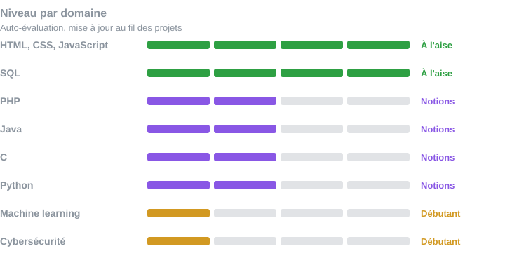
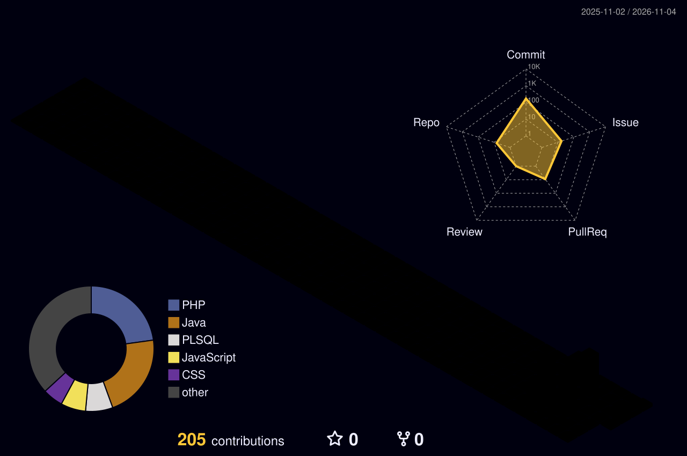

<!-- En-tête animé -->

  

  
  

## Présentation

Je suis Elyas, développeur et passionné de machine learning. Ce qui m'attire, c'est la vision par ordinateur et la façon dont les réseaux de neurones et les grands modèles de langage apprennent. J'ai commencé à faire mes premiers projets de machine learning en Python, et je m'intéresse aussi à la cybersécurité.

## Domaines

| Domaine | Où j'en suis | Ce que je veux apprendre |
| --- | --- | --- |
| Machine learning | Premiers projets en Python | Préparer des données, entraîner et évaluer un modèle |
| Développement | Ma base, web et Java | Écrire du code plus propre et mieux testé |

## Niveau

  

## Technologies

  

  
  
  

## Projet

| Projet | Contenu | Technologies |
| --- | --- | --- |
| Jeu de memory | Jeu sans bibliothèque, 3 niveaux, chronomètre, meilleur score enregistré | JavaScript |

## Activité GitHub

  

  <picture>
    <source media="(prefers-color-scheme: dark)" srcset="./profile/stats-dark.svg">
    
  </picture>
  <picture>
    <source media="(prefers-color-scheme: dark)" srcset="./profile/langs-dark.svg">
    
  </picture>

## Langues

Persan (langue maternelle), français et anglais (B1 avancé).

Je m'aide d'assistants IA pour structurer et relire mon travail.

